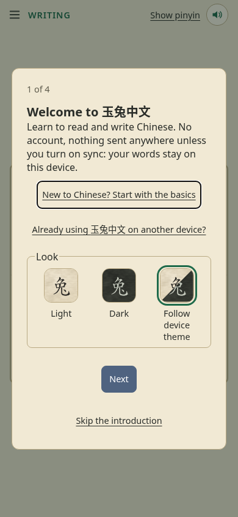
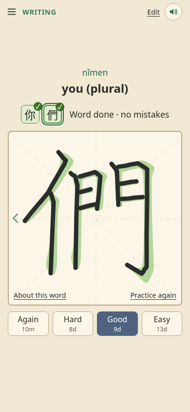
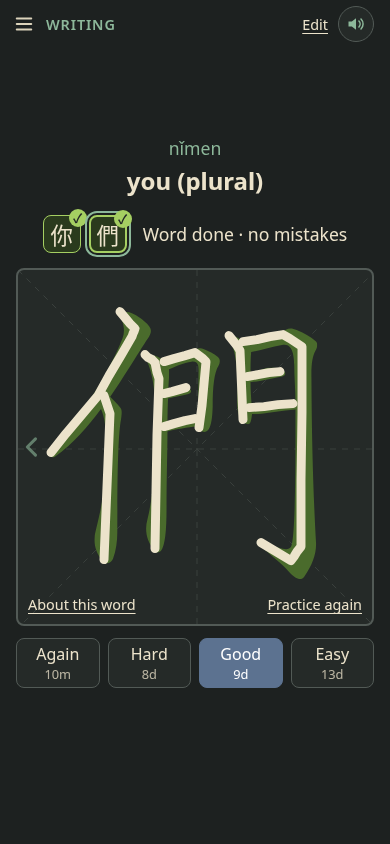

# 玉兔中文 (Yutu Chinese)

玉兔, the Jade Rabbit, lives on the moon.

A free app for learning to write Chinese characters, and to read, pronounce and understand the words they make. It runs in the browser, needs no account, and works offline.

**Use it at https://bunnyapocalypse.github.io/yutu-chinese/**

On a phone or tablet, choose "Install app" or "Add to Home Screen" from the browser's menu. The interface is in English, Italian and German.

<p>
  
  
  
</p>

## What it does

### Writing

- **Write with your finger, a stylus or a mouse.** Your handwriting stays on screen as you drew it ("raw input"), or each stroke can snap to the printed one.
- **Grading that isn't fussy.** Awkward strokes pass when written reasonably, and common shortcuts are accepted, such as 子 in two strokes.
- **Traditional, simplified, or both, each first-class.**
- **Gestures:** hold for a hint, swipe up to start the character again.

### Studying

- **Four kinds of card for each word:** writing, tone, pinyin and meaning, each scheduled on its own with [FSRS](https://github.com/open-spaced-repetition/ts-fsrs).
- **Learn:** a short lesson for each new word, stroke by stroke, before it comes up in Review.
- **Review:** the cards that are due. You grade yourself, and the app suggests a grade where it can check your answer.
- **Leeches:** cards you keep forgetting are pointed out or suspended, and can be copied as a prompt for an AI to make memory aids.
- **Sentences:** read a sentence, or write the missing word.
- **Mainland or Taiwan pronunciation, or both.**

### Words and decks

- **Add your own words**, filled in from the built-in dictionary, or whole lists from a file.
- **Ready-made lists:** HSK 3.0, HSK 2.0, TOCFL and the 214 Kangxi radicals.
- **Decks and sub-decks.** A word can be in several decks and keeps one schedule.
- **A page for every word:** how its characters are built, tips for remembering them, an example sentence, and its cards.
- **Recordings** of native speakers for most words.
- **Progress:** your cards, the days you studied, time spent, and words learned over time.

### Bringing your history along

Import from **Anki** (`.apkg`, `.colpkg`) or **Skritter** (the `.zip` its support sends on request), schedules and review history included.

### Looks

Light, dark, or following the device, and the OpenDyslexic font as an option.

## Your data

**Everything is stored on your device.** There is no account, and nobody but you can read your words or your progress.

- **Sync between devices** (optional): turn it on in Settings, save the sync code, and enter or scan it on your other devices. Everything is encrypted on the device before it is sent. You can run your own sync server (below).
- **Backups:** Export backup saves everything as one file; Import backup loads it on any device.
- **Keep your sync code somewhere safe.** Without it, nobody can open your synced data, us included.

## Running your own sync server

Syncing goes through our server by default, but anyone can run one: for themselves, a household, a club or a school. It is a small program of our own (`server/server.js`): plain Node.js with no dependencies, keeping each learner's encrypted files in a folder of their own. How syncing works, and why the server is built this way: `docs/sync.md`.

### What you need

- **A Linux machine reachable from the internet**, such as a small rented server (a VPS). Two cores and 4 GB of memory are plenty for thousands of learners; ours is an ARM server at Hetzner in Germany, about €7 a month.
- **A domain name** with A (IPv4) and AAAA (IPv6) records pointing straight at the machine, **not through a proxy** such as Cloudflare's orange cloud: the proxy would see every request's secret, and the server must see learners' own addresses for its limits.
- An **HTTPS** front: the app only talks to a sync server over HTTPS (except one on the same computer).

### The easy way: our Ansible playbooks (AlmaLinux 10 or Rocky Linux 10)

The playbooks in `deploy/` set up a fresh machine from your own computer over SSH, the same way as ours: key-only SSH logins, a firewall, security updates by themselves, the program as a locked-down service, Caddy for HTTPS with certificates it renews by itself, the log kept at most 14 days, and an optional watch that emails you. In short:

1. Install Ansible on your computer (on Fedora: `sudo dnf install ansible`).
2. `cd deploy`, then `cp inventory.example.yml inventory.yml`, and fill in the machine's address, your domain name, and the site the app is opened from (`https://bunnyapocalypse.github.io` for ours).
3. The first run, as root: `ansible-playbook setup.yml -e ansible_user=root`. From then on the playbooks log in as an admin account of their own.
4. Later: `deploy.yml` after changing the program or a setting, `update.yml` monthly, `status.yml` to see how it is doing.

The full steps, every setting, and the watch: `deploy/README.md`.

### By hand, on any Linux

1. Install **Node.js 22** or newer, and copy `server/server.js` and `server/package.json` to the machine.
2. Run it as an account of its own with your system's service manager. Ours, for systemd, with the settings that keep the program from touching anything but its own folder, is `deploy/templates/yutu-sync.service.j2`.
3. Give it its settings in the environment (every one: `server/README.md`). At least `DATA_DIR` (where the files go), `ALLOWED_ORIGINS` (the site the app is opened from, `https://bunnyapocalypse.github.io` for ours) and `TRUST_PROXY=1`. It listens on `127.0.0.1:8787` only.
4. Put an HTTPS server in front of it, passing requests on to `127.0.0.1:8787` and **replacing** any `X-Forwarded-For` header the learner sent with their real address (Caddy does both by itself; ours is `deploy/templates/Caddyfile.j2`, four lines). Let it accept request bodies of 65 MB.
5. Check: `https://<your domain>/v1/health` answers `ok`.

### Pointing the app at it

On each device, before turning sync on or joining: Settings › Your data and backups › Sync between devices, unfold "Sync server", enter `https://<your domain>` and choose "Use this server". In the introduction it is under "Self-hosting?". A sync code's link and QR code made on such a device carry the server along, so the other devices join it by themselves.

### What running one means

- **You hold other people's data**, even though it is encrypted. The app's privacy page ("How syncing handles your data") describes our server, not yours: tell your learners who runs yours, where, and how long you keep things. In the EU, the GDPR applies to you as for us.
- **The log names an address only when it goes over a limit** (lines starting `LIMIT`). Keep the log short (ours: 14 days) and say so.
- **Keep it updated.** The playbooks do so by themselves; by hand, turn on your system's automatic security updates.
- **No backups needed:** every device keeps everything and sends it all again if the server loses it. Stopping the server loses nobody's words; syncing just stops.
- **Limits** keep one person from filling the server or using it as free storage. For a school whose class turns sync on together, give its address more room: `GENEROUS_ADDRESSES` (`server/README.md`).

## Feedback

"Send feedback" in the app's menu, or this repository's [issue tracker](https://github.com/BunnyApocalypse/yutu-chinese/issues).

## Developing

You need [Node.js](https://nodejs.org/) 20.19 or newer (22 or newer for the browser tests and the sync server).

```
npm install            # once, downloads the dependencies
npm run dev            # the app at http://localhost:5173
npm test               # unit tests
npm run test:browser   # the real app in headless Chromium, about four minutes
npm run sync-server    # a sync server on this computer, http://127.0.0.1:8787
npm run build          # the published version, in dist/
```

The browser tests need Chromium or Chrome. On a phone on the same Wi-Fi, open the "Network" address Vite prints.

It is plain JavaScript built with [Vite](https://vite.dev/), with [Hanzi Writer](https://hanziwriter.org/) for showing and grading strokes. The design notes are in `docs/` (start at `docs/README.md`).

Pushing `main` publishes a test copy at https://bunnyapocalypse.github.io/yutu-chinese/test/; the `stable` branch is the main one.

## License and credits

The app's own code is free software under the GNU General Public License, version 3 only: see [LICENSE](LICENSE).

It is built on the work of others, each under its own license (each data folder has a README with its source):

- **Stroke data:** [Make Me a Hanzi](https://github.com/skishore/makemeahanzi) (by way of [hanzi-writer-data](https://github.com/chanind/hanzi-writer-data)) and [AnimCJK](https://github.com/parsimonhi/animCJK) for Taiwan's forms (`data/animcjk/`), Arphic Public License. Not GPL-compatible, so kept as separate data files.
- **How characters are built:** Make Me a Hanzi's dictionary (`data/makemeahanzi/`), GNU LGPL.
- **Dictionary and tones:** [CC-CEDICT](https://cc-cedict.org/wiki/) (`data/cedict/`), CC BY-SA 4.0.
- **Recordings:** [audio-cmn](https://github.com/hugolpz/audio-cmn) (`data/audio-cmn/`), CC BY-SA.
- **Learning notes, example sentences and character tips** (`data/notes/`, `data/character-tips/`): written for this app by an AI model (Anthropic's Claude), CC BY-SA 4.0. Not all have been checked by a fluent speaker; the app says which have.
- **Word lists:** HSK from [ivankra/hsk30](https://github.com/ivankra/hsk30) and [glxxyz/hskhsk.com](https://github.com/glxxyz/hskhsk.com) (MIT); TOCFL from the list published by Taiwan's Steering Committee for the Test of Proficiency-Huayu, which states no license; the Kangxi radicals from Unicode's CJKRadicals.txt (`data/wordlists/`).
- **The OpenDyslexic font** (`public/fonts/opendyslexic/`): SIL Open Font License 1.1, kept as separate font files.
- **Libraries:** [Hanzi Writer](https://github.com/chanind/hanzi-writer), [ts-fsrs](https://github.com/open-spaced-repetition/ts-fsrs), [sql.js](https://github.com/sql-js/sql.js) and [fzstd](https://github.com/101arrowz/fzstd) (reading Anki files), [qrcode-generator](https://github.com/kazuhikoarase/qrcode-generator) (MIT) and [jsQR](https://github.com/cozmo/jsQR) (Apache 2.0) for the sync code's QR code.

The full list is under Help › Credits and licenses in the app.

Skritter is a trademark of Inkren Inc. 玉兔中文 can import the data Skritter sends you, but is not affiliated with or endorsed by Skritter.
